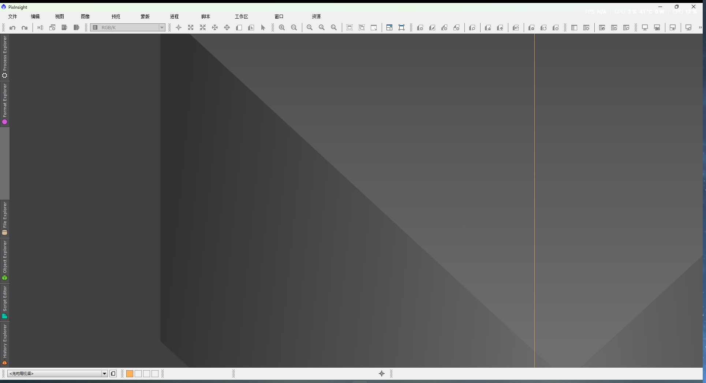
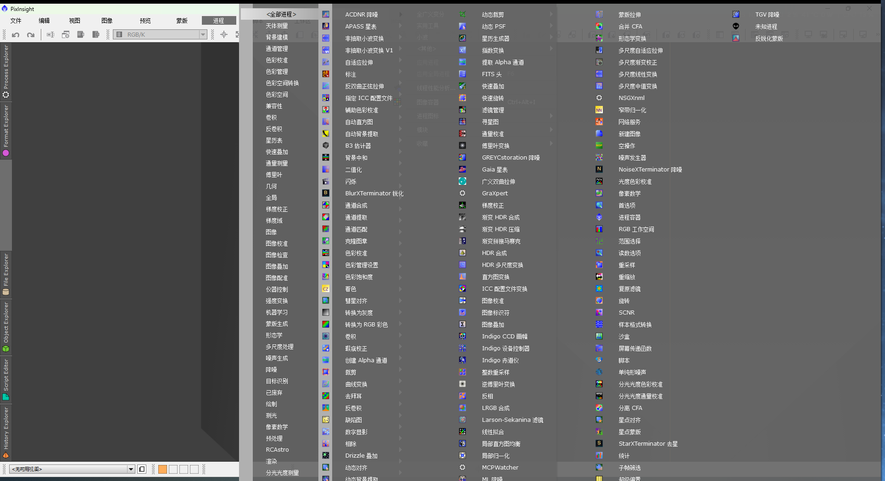
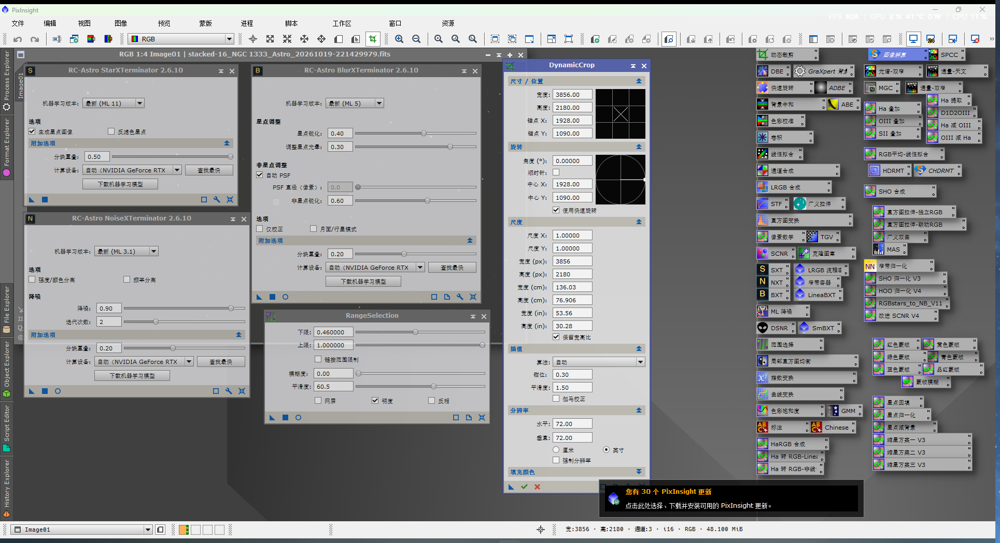
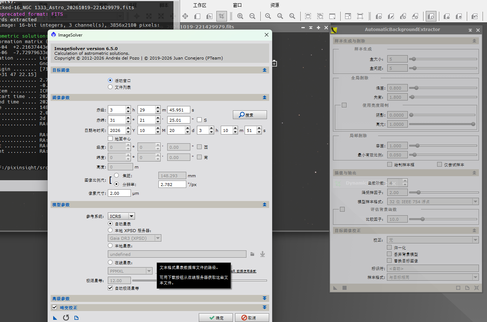

# PixInsight 中文

一个 PixInsight 的**外挂式简体中文汉化**：不改动 PixInsight 的任何原始文件，通过一个启动器把外置 DLL 注入进程，在 Qt 显示层把英文实时替换为中文。删除 `zh_cn` 文件夹即完全还原。

> 本项目与 PixInsight 官方（Pleiades Astrophoto S.L.）无任何关联。不包含、不链接、不分发 PixInsight 本体或其安装包。词典中的界面文案翻译为本项目自行撰写，用于正版用户界面本地化。

项目主页：<https://github.com/bibilabu777/pixinsight-zh-cn>

当前版本：**v1.3.2**　词典 **25,911 条**　适配 **PixInsight 1.9.6 / Windows Qt6 x64**

> **测试状态**：目前仅在 **PixInsight 1.9.6** 和 **1.9.5**（Windows / Qt6 x64）上实测通过；其他版本请自行测试。

---

## 获取

| 方式 | 说明 |
|---|---|
| 克隆仓库 | `git clone https://github.com/bibilabu777/pixinsight-zh-cn.git` |
| 下载压缩包 | 页面右上 `Code` → `Download ZIP` |

仓库里的文件即可直接用，无需编译。下载后可核对校验值（PowerShell）：

```powershell
Get-FileHash .\zh_cn.tsv -Algorithm SHA256
```

把结果与 `SHA256SUMS.txt` 中对应行比对，一致即说明文件完整未被改动。

---

## 使用方法

**前提**：自备一份合法授权的 PixInsight（Windows 版，Qt6 x64）。

### 安装

1. 解压压缩包到任意位置。
2. 双击 `安装.bat`，弹出图形化安装窗口，选择你的 PixInsight 安装目录（包含 `bin\PixInsight.exe` 的那一层）。
3. 安装完成后，桌面出现「PixInsight 中文」快捷方式，双击即以中文界面启动。

也可以不安装，直接把 `pi_zh_loader.exe`、`pi_zh.dll`、`zh_cn.tsv` 三个文件复制到 `<PI 根目录>\zh_cn\`，然后双击 `pi_zh_loader.exe`。

### 启动

| 操作 | 方式 |
|---|---|
| 中文界面 | 双击桌面「PixInsight 中文」，或运行 `pi_zh_loader.exe` |
| 英文原版 | 直接运行 `bin\PixInsight.exe`（原版文件未被改动） |

启动参数（可选）：

| 参数 | 作用 |
|---|---|
| `--root <目录>` | 指定 PixInsight 安装目录；也可用环境变量 `PI_ZH_ROOT` |
| `--no-doc` | 不切换 PJSR 帮助文档语言 |
| `--no-wf` | 不自动加载 `zh_cn\workflow.xpsm` |
| `--help` | 显示帮助 |

不指定 `--root` 时，默认把 `zh_cn` 的上一级目录当作 PI 根目录，所以换 PI 版本只需把整个 `zh_cn` 文件夹复制到新版本根目录即可，无需重新编译。

### 卸载

删除 `<PI 根目录>\zh_cn\` 整个文件夹，再删掉桌面快捷方式即可。PixInsight 本体从未被修改。

### 排查

- **界面全英文**：确认是用 `pi_zh_loader.exe` 启动，而不是直接运行 `PixInsight.exe`。
- **提示「汉化模块注入失败」**：多为安全软件拦截 DLL 注入，把 `zh_cn` 目录加入白名单后重试。

---

## 界面截图

以下截图取自 PixInsight 1.9.6（Windows / Qt6 x64），全部为实际运行效果，未做后期修饰。

| 主界面与菜单 | 全部进程菜单 |
|---|---|
|  |  |

| 多个处理对话框同时中文 | 参数提示与消息框 |
|---|---|
|  |  |

说明：

- 菜单、对话框、按钮、下拉项、分组标题均为词典替换。
- 参数悬停提示（tooltip）为富文本（`<p>` 段落）形式，词典按**完整串**匹配，因此必须整段翻译才会生效。
- 左侧资源管理器栏（`Process Explorer` 等）**仍是英文**，原因见 [已知限制](#已知限制)。

---

## 仓库结构

```
bin/pi_zh.dll          注入模块（Qt 显示层替换）
bin/pi_zh_loader.exe   外挂启动器（注入 + 启动 PixInsight）
src/pi_zh.cpp          注入模块源码
src/loader.cpp         启动器源码
src/build.py           构建脚本（MSVC x64）
src/tools/scan_js.py   脚本界面文案扫描工具（核对词典覆盖、导出未命中清单）
zh_cn.tsv              词典：英文原文 <TAB> 中文译文，UTF-8 BOM + CRLF
install_gui.ps1        图形化安装器
安装.bat               安装入口
使用说明.txt           面向使用者的完整说明
CHANGELOG.md           更新日志
docs/screenshots/      实机效果图（README 内嵌）
SHA256SUMS.txt         随包文件校验值
```

## 从源码构建

`bin/` 里的二进制与 `src/` 中的源码一致，可直接使用；想自己重编：

```bat
python src/build.py
```

需要 **Visual Studio 2019/2022 的 MSVC x64 生成工具 + Windows 10/11 SDK**。构建脚本通过 `vswhere` 和注册表自动定位编译器与 SDK，工程根目录由脚本自身位置推导，不依赖任何本机绝对路径；找不到编译器时会给出明确报错而不是中断在无意义的路径上。产物写入 `build/` 并同步到 `bin/`，之后重新生成 `SHA256SUMS.txt` 即可。

### 词典格式

- UTF-8 **带 BOM**、**CRLF** 换行、一行一条 `英文原文<TAB>中文译文`。
- 键里不能放真实换行，需要换行写成字面 `\n`（两个字符）。
- **译文里不要写 `\n`**：DLL 只把键里的 `\n` 还原用于匹配，不会把值里的 `\n` 还原成换行，写进去就会在界面显示成反斜杠加 n。多行标签请写单行译文。
- 同一英文原文只保留**第一次**出现的那条，重复键后者无效——想改某条译文请就地修改，追加是没用的。
- **会被程序读回的文本不要译**：脚本里 `combo.addItem("Strong")` 之后若又 `engine.mode = this.itemText(i)` 并 `if (this.mode == "Strong")`，那么把 `Strong` 译成中文就等于把逻辑常量改了，功能会静默失效。这类字符串用 `--readback` 先查，确认后再决定。

### 查漏（扫描未汉化的界面文案）

`src/tools/scan_js.py` 会遍历 PixInsight 的 JS 脚本目录，抽出界面字符串并按 DLL 的匹配链（精确 → 去尾空白 → 去尾冒号 → 去 `&` → 剥富文本标签 → 真换行转字面 `\n`）核对词典，输出未命中清单：

```bat
python src/tools/scan_js.py "<PI根目录>\src\scripts" --dict zh_cn.tsv
```

输出每行为 `文件:行号<TAB>英文原文`，可直接对照补词条；词条格式与去重规则同上一节。

补汉化之前，建议先跑一次**回读冲突审计**——它会列出「下拉项被词典翻译、但脚本又把该项文本读回来做比较」的位置（当前 PI 1.9.6 全量扫描为 90 处 / 21 个文件（已按控件变量关联过滤，仍可能有少量误报））：

```bat
python src/tools/scan_js.py "<PI根目录>\src\scripts" --dict zh_cn.tsv --readback
```

命中的词条应从词典**撤回**，否则脚本逻辑会因文本被改写而失效。

---

## 已知限制

| 现象 | 原因 | 能否修复 |
|---|---|---|
| 左侧栏 `Process Explorer / Format Explorer / Object Explorer / Script Editor / History Explorer / File Explorer` 仍为英文 | 这 6 个字符串词典里都有，但 PI 核心通过一张**私有函数指针表**（3164 项）调用 Qt，不走导入表，DLL 现有钩子覆盖不到 | 需要重编 DLL 增加对该指针表的扫描，属于改源码范畴，本版未做 |
| 少数按钮文本仍是英文 | 运行时字符串两侧带空格（如 ` Auto Stretch `），而词典加载时会裁掉键首空格，永远命中不了 | 需改 DLL 的键裁剪逻辑 |
| 部分长帮助段落仍是英文 | 运行期由 `字面量 + VERSION + 字面量` 拼成，拼完的整串无法预知 | 无法用词典覆盖 |
| 脚本里少数下拉项仍是英文（如 Star Reduction 的 `Strong / Moderate / Soft`、`Reduction method` 四项） | 这些下拉项的文本会被脚本**读回**再与英文常量比较（`engine.method = this.itemText(index)` 后 `if (this.method == "Star Method")`）。词典在 `addItem` 入口替换的是控件里的模型文本，`itemText()` 于是返回中文，比较必然落空，脚本静默失效 | 翻译即破坏功能，按规则**不译**；根治需改脚本按索引取值，或用 `--readback` 查出后从词典撤回 |

---

## 合规说明

- 本仓库仅发布**自有代码**（启动器、注入模块、构建脚本、词典）与说明文档，采用 MIT License。
- **不包含、不链接、不分发** PixInsight 的二进制、安装包、官方 DLL 或官方文档文件。
- 运行期替换只发生在内存显示层，**程序文件（`PixInsight.exe` 与各 `*-pxm.dll`）一个字节都不改**；删除 `zh_cn` 目录即完全还原。
- 不涉及授权、序列号、激活、试用或任何形式的破解——只做显示层界面翻译。
- 词典中的中文译文为本项目自行撰写，供已获正版授权的用户做界面本地化使用。
- PixInsight 是 Pleiades Astrophoto S.L. 的商标，与本项目无关。使用本项目前，请确认你拥有合法的 PixInsight 授权，并自行遵守其最终用户许可协议。

## License

自有代码与词典采用 MIT License（见 `LICENSE`）。
